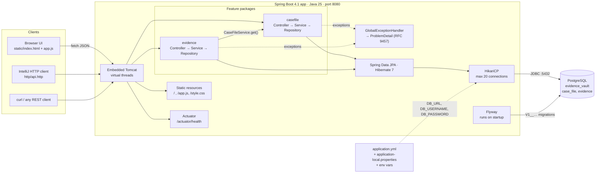
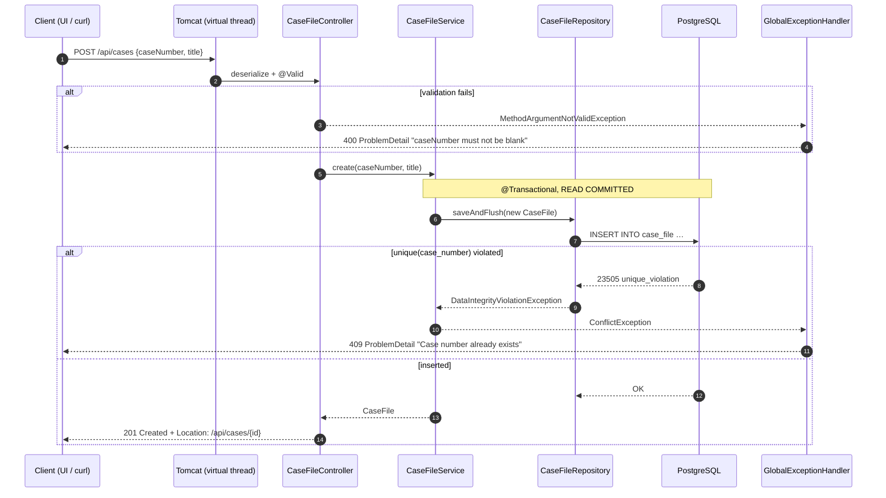
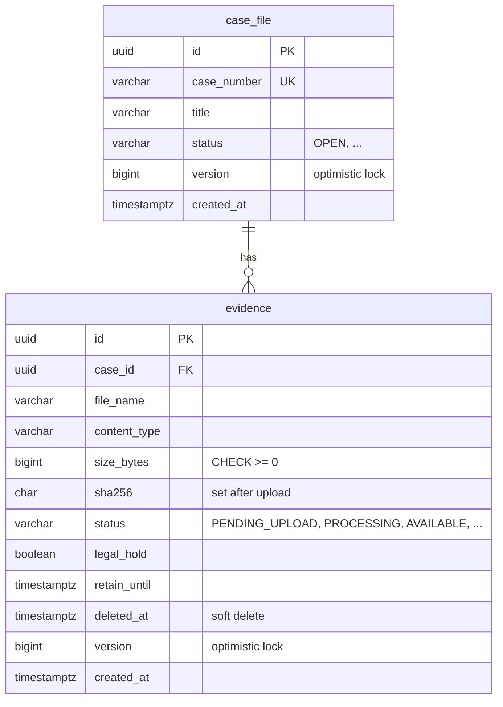
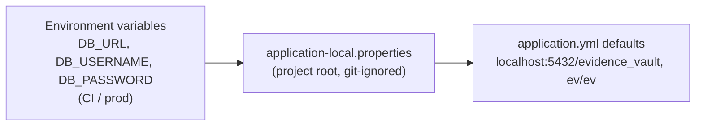
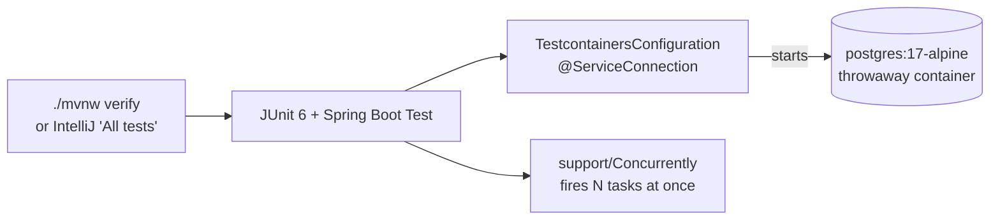

# Architecture and usage

How Evidence Vault is wired, how a request flows through it, and how to use it locally.
Roadmap and planned modules: [`PLAN.md`](PLAN.md). Concurrency write-ups: [`concurrency/`](concurrency/).

## 1. System overview

One Spring Boot process (a modular monolith) serves both the REST API and a minimal static UI,
and talks to a single PostgreSQL database.



**Key points**
- **Package by feature.** Each feature (`casefile`, `evidence`, and later `retention`, `custody`, `jobs`, …) owns
  its controller, service, repository and entity. A feature calls another feature only through its service,
  e.g. `EvidenceService` → `CaseFileService.get()`.
- **Schema is owned by Flyway.** Hibernate only validates it (`ddl-auto: validate`), so entity and SQL
  mismatches fail fast at startup.
- **Invariants live in the database.** Uniqueness, foreign keys and `CHECK` constraints are the source of
  truth. Java never does check-then-act for invariants.
- **One error format.** Every error, including Spring MVC's own (validation, malformed JSON, 405), is returned
  as `application/problem+json`.

## 2. Request lifecycle

Example: `POST /api/cases`, including the concurrent-duplicate case.



There is no `existsByCaseNumber()` pre-check. With 20 concurrent requests for the same case number,
the unique constraint lets exactly one through and the other 19 get 409. `CaseFileConcurrencyTest` proves this.

## 3. Data model



- `idx_evidence_retention` is a partial index on `retain_until WHERE deleted_at IS NULL AND legal_hold = FALSE`.
  It exists for the retention job in Phase 1.
- `version` columns back JPA optimistic locking. A lost update surfaces as
  `ObjectOptimisticLockingFailureException`, which is returned as 409.

## 4. Write paths: transaction boundaries

| Endpoint | Service method | Transaction | Isolation | Invariant enforced by |
|---|---|---|---|---|
| `POST /api/cases` | `CaseFileService.create` | `@Transactional` | READ COMMITTED (Postgres default) | `UNIQUE (case_number)` |
| `POST /api/cases/{caseId}/evidence` | `EvidenceService.register` | `@Transactional` | READ COMMITTED | `FOREIGN KEY (case_id)`, `CHECK (size_bytes >= 0)` |

Read endpoints use `@Transactional(readOnly = true)`. `open-in-view` is disabled, so no lazy loading happens
outside a service transaction.

## 5. Configuration

Values are resolved in this order (first wins):



| File | Committed | Purpose |
|---|---|---|
| `src/main/resources/application.yml` | yes | All settings, with `${DB_…:default}` placeholders |
| `application-local.properties` | no | Your machine's DB credentials |
| `application-local.properties.example` | yes | Template for the above |

## 6. Tests



Tests never touch your local database. Each run gets a fresh Postgres in Docker, and Flyway migrates it.
Docker must be running for tests, but not for running the app.

## 7. How to use

### First-time setup
1. Install JDK 25 and PostgreSQL. Docker is needed only for the tests.
2. Create the database and a login:
   ```sql
   CREATE ROLE ev LOGIN PASSWORD 'ev';
   CREATE DATABASE evidence_vault OWNER ev;
   ```
3. If your credentials differ, copy `application-local.properties.example` to `application-local.properties`
   and edit it.

### Run
- **IntelliJ:** pick **Evidence Vault** in the run dropdown and press ▶. **All tests** runs the test suite.
- **Terminal:** `./mvnw spring-boot:run`, and `./mvnw verify` for the tests.

Flyway creates or updates the tables on startup. Restart the app after changing Java code or files in `static/`.

### Use the UI: http://localhost:8080
1. The header badge shows `API UP` once the backend is healthy.
2. **New case:** enter a case number and a title. The case opens automatically.
3. **Register evidence:** file name, content type, size and an optional retain-until date, which must be in
   the future. The table shows each item's status (`PENDING_UPLOAD`), legal hold and retention date.
4. **Cases:** paste a case ID, or click one of the 10 recently opened cases. This list is stored in the browser.
5. Errors appear bottom-right with the server's `ProblemDetail` message.
   Creating the same case number twice shows the 409 conflict.

### Use the API directly
Open `http/api.http` in IntelliJ and press ▶ on each request from top to bottom. The created case ID is
captured automatically. Or use curl:

```bash
# create a case
curl -i -X POST localhost:8080/api/cases -H 'Content-Type: application/json' \
     -d '{"caseNumber":"C-2026-001","title":"Burglary at 5th Ave"}'

# register evidence (use the id from the response above)
curl -X POST localhost:8080/api/cases/{caseId}/evidence -H 'Content-Type: application/json' \
     -d '{"fileName":"bodycam-0001.mp4","contentType":"video/mp4","sizeBytes":104857600,"retainUntil":"2030-01-01T00:00:00Z"}'

# list evidence
curl localhost:8080/api/cases/{caseId}/evidence
```

| Method | Path | Success | Errors |
|---|---|---|---|
| GET | `/actuator/health` | 200 `{"status":"UP"}` | 503 if DB is down |
| POST | `/api/cases` | 201 + `Location` | 400 validation, 409 duplicate `caseNumber` |
| GET | `/api/cases/{id}` | 200 | 404 |
| POST | `/api/cases/{caseId}/evidence` | 201 | 400 validation, 404 unknown case |
| GET | `/api/cases/{caseId}/evidence` | 200 (excludes soft-deleted) | 404 unknown case |

Error body example:
```json
{ "title": "Conflict", "status": 409, "detail": "Case number already exists: C-2026-001", "instance": "/api/cases" }
```

## 8. Where this is going

The empty packages (`retention`, `custody`, `jobs`, `outbox`, `idempotency`, `upload`, `sharing`) each hold a
`package-info.java` describing the concurrency problem they will solve. The first one is the legal-hold vs
retention-delete write skew; see `PLAN.md` §3.
